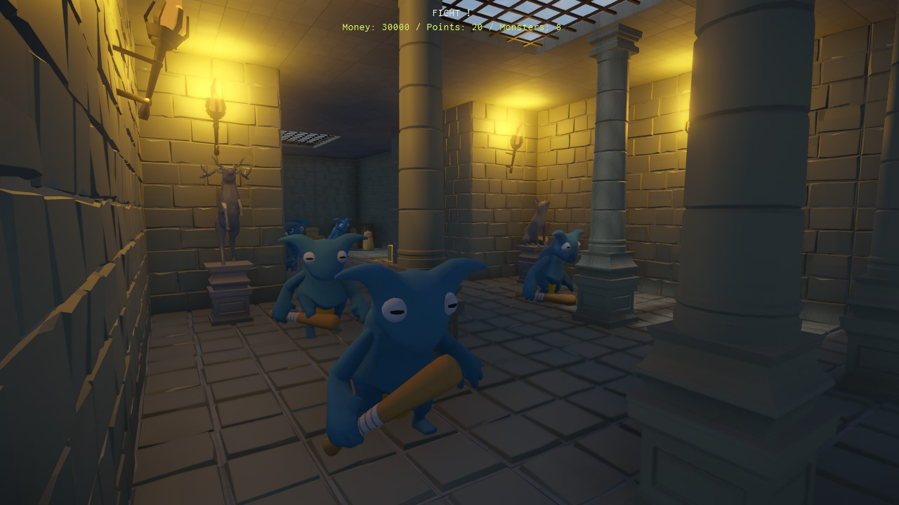

# Monster Attack Game Project

Monster Attack is a demo project for how to make a game with EZ engine. It is heavily inspired by the immensely fun tower defense game [Orcs Must Die!](https://store.steampowered.com/app/102600/Orcs_Must_Die/) (go check that out too!).
The demo is meant both to showcase what the engine can do and to show how various game mechanics can be implemented.

If you are interested in EZ, you are encouraged to check out this project, play around with it and see how things are set up.

However, this project is work-in-progress. If you like, you are welcome to contribute to it.

Click the image below to see a playthrough video (of an older version, before the hub and the HUD were added):

## How to Build

This repository is fully self-sufficient, since it pulls in ezEngine as a submodule. This guarantees that it uses the correct version.

1. Clone this repository:\
   `git clone https://github.com/ezEngine/project-monster-attack.git`
1. Change directory:\
   `cd project-monster-attack`
1. Make sure you have all the necessary submodules:\
   `git submodule init`\
   `git submodule update`
1. Generate ezEngine solution for Visual Studio:\
   `cd ezEngine`\
   `GenerateWin64vs2022.bat` (or `GenerateWin64vs2026.bat`)
1. Open the generated solution from `ezEngine/Workspace`.
1. Build Dev or Debug build.
1. Run the editor.
1. In the dashboard under *Projects* select **Browse...** and select the file `project-monster-attack/Monster Attack/ezProject`
1. When asked to build the engine plugin, click *Apply*.
1. Open the *Scene* **Main** (the hub) or one of the levels (**Level1** to **Level4**).
1. To edit / compile the C++ plugin, choose `Project > C++ Project > Open Solution`
1. To play the game from the editor, press `Ctrl+F5`
1. To play the game in stand-alone mode, press `Ctrl+R` and choose **Export & Run**. The stand-alone game (`MonsterAttackGame`) always starts in the hub.

## How to Play

The game starts in a small hub room with four doorways. Walk through a doorway to enter a level. Doorways of levels that you have already won are marked.

In each level, monsters walk from their spawn points to a goal. Use the build phase to place traps along their path, then start the wave. If too many monsters reach the goal, you lose. Once all waves are done, or you lost, you return to the hub.

* **Magic Bullet:** Free, shoots whatever you aim at.
* **Spike Trap:** Placed on the floor, damages monsters walking over it.
* **Arrow Trap:** Placed on walls, shoots darts at monsters walking by.
* **Tar Trap:** Placed on the floor, slows monsters down.

## Game Controls

* *WSAD* + Mouse for first person movement
* *Shift* to run
* *Space* to jump
* *Left click* to shoot or place a trap
* *1* - *4*, *Q* / *E* or the *mouse wheel* to switch between your gun and the different traps
* *G* to start the next wave
* *Right Ctrl* also shoots, the *arrow keys* look around
* *ESC* to open the main menu, which has settings for graphics, audio and key bindings

Game controllers are supported as well. The HUD always shows the prompts for the device that was used last.

## Project Overview

This is where to look for how things are done:

| Folder / File | What it shows |
|---|---|
| `CppSource/MonsterAttackPlugin` | The game plugin with all custom C++ code. |
| `CppSource/MonsterAttackPlugin/GameState` | The game state: the game loop across scenes (starting in the hub, returning to it after a level), the main menu and filling the HUD blackboard. |
| `CppSource/MonsterAttackPlugin/Components/PlayerComponent` | Player input, character movement, selecting items and placing traps via physics raycasts. |
| `CppSource/MonsterAttackPlugin/Components/MonsterComponent` | Monster logic: navigation to the goal, reacting to the ground surface (tar), damage, ragdolls and money rewards. |
| `CppSource/MonsterAttackPlugin/Components/LevelPortalComponent` | Hub doorways: trigger messages, loading scenes and remembering progress in a global blackboard. |
| `CppSource/MonsterAttackGame` | The stand-alone game application. |
| `Logic` | The level flow, shared by all levels: a state machine (build, countdown, fight, win / lose phases), visual scripts for the phases and monster waves, and the blackboard template with the level settings. |
| `Traps` | Trap prefabs. The spike trap uses a state machine and visual script, the arrow trap a state machine. |
| `UI` | The HUD, made with RmlUi and data bound to the `LevelState` blackboard. |
| `Scenes` | `Main` is the hub, `Level1` to `Level4` are the levels. `Creatures` is a test scene for the monsters. |

Blackboards are the central way for data to flow between C++, visual scripts, state machines and the UI:

* `LevelState` is a global blackboard with the state of the current level (phase, money, lives, ...). Each scene initializes it from its blackboard template, the HUD displays it.
* `Progress` is a global blackboard that remembers which levels were won. It stays alive across scene changes.

## Useful Resources

EZ has extensive [online documentation](https://ezengine.net/pages/docs/docs-overview.html). There are also [videos on YouTube](https://www.youtube.com/@ezEngine/videos) about various topics. We also have a [Discord server](https://ezengine.net/pages/contact.html#questions-and-discussions) where we've been describing this project in more detail.

## Future Work & Contributions

This is a list of things that could be done to play around with the demo. Feel free to contribute to the project. If you want to check-in assets, make sure they are under a free license (MIT or CC0). So far we have been using assets from [Quaternius](https://quaternius.com/), [Kenney](https://kenney.nl/) (UI, input prompts, particles and decals), [freesound.org](https://freesound.org/), [Sonniss](https://sonniss.com/gameaudiogdc) and Free3D.

### Level Design

* More levels, with more varied layouts and waves
* Modular Level pieces:
  * Stairs
  * Pits (water / lava)
* More decorative elements

### Sounds

Additional sounds could be added for these things:

* Monster footsteps
* Monster spawn
* Monster reaches goal
* Monster death
* Level ambience / music
* Different level phase music (build, countdown, fight, win/lose)
* Trap placement
* Player wins
* Player loses

### Particle Effects

* Better hit / blood effects
* Torch fire
* Goal magic portal thingy
* Hub doorway effects
* Death explode effect
* Impact effects for darts / magic bullets that depend on the surface type
* Ambient smoke / haze
* Monster reaches goal
* Monster spawn / spawn phase begin

### AI

* Steering that avoids other monsters
* Different behaviors, e.g. monsters that attack the player or traps

### Monsters

* Different monster meshes and animations (needs free assets)

### Traps

* More trap types
* Better trap placement (proper validation where one can be placed)
* Selling traps functionality

### Shaders

* Highlight shader (for selecting traps to sell)
* Different shading during trap placement (preview)

### UI

* Show playtime
* Show the health of monsters

### Standalone App / Game Loop

* Unlocking levels one after another
* Restart level when player loses
* Allow player to restart level any time
